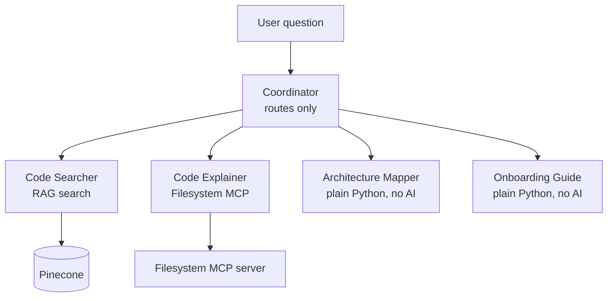
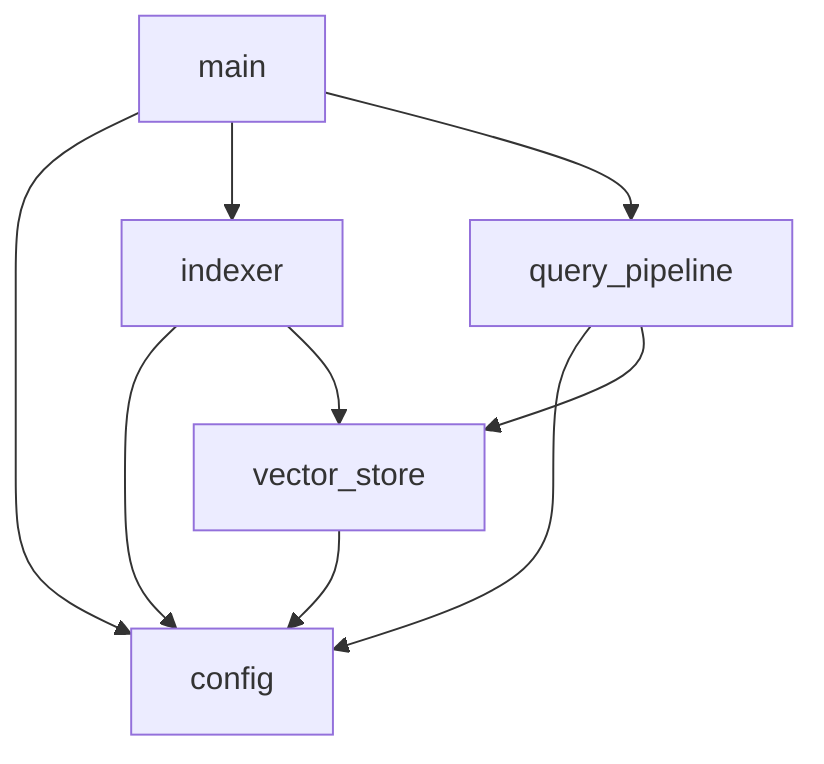
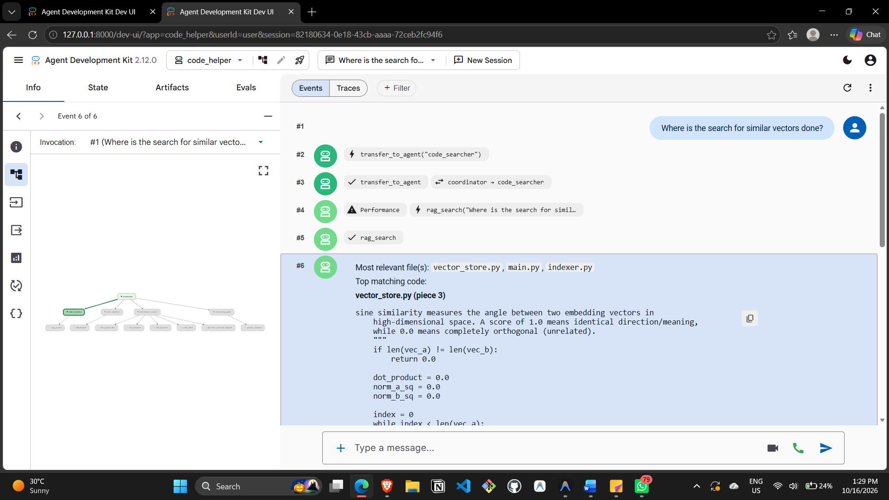
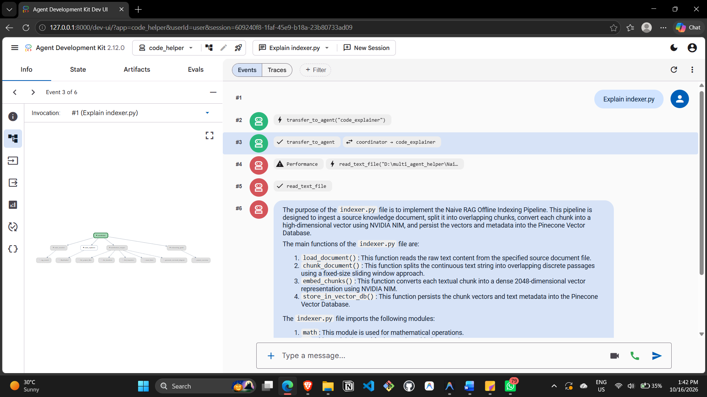
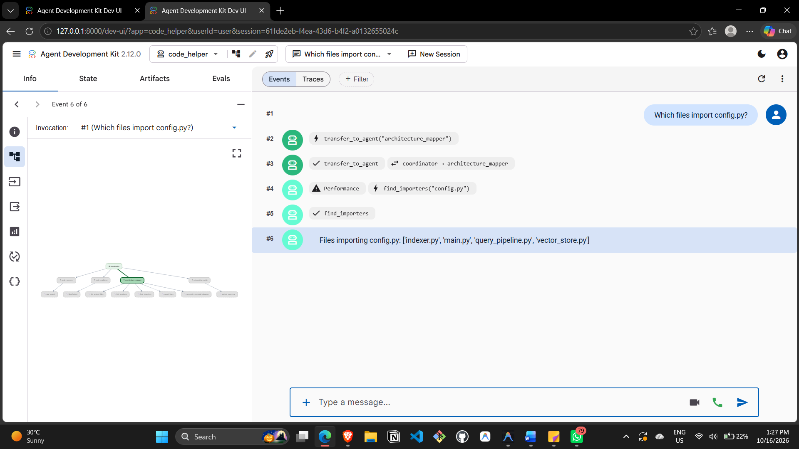
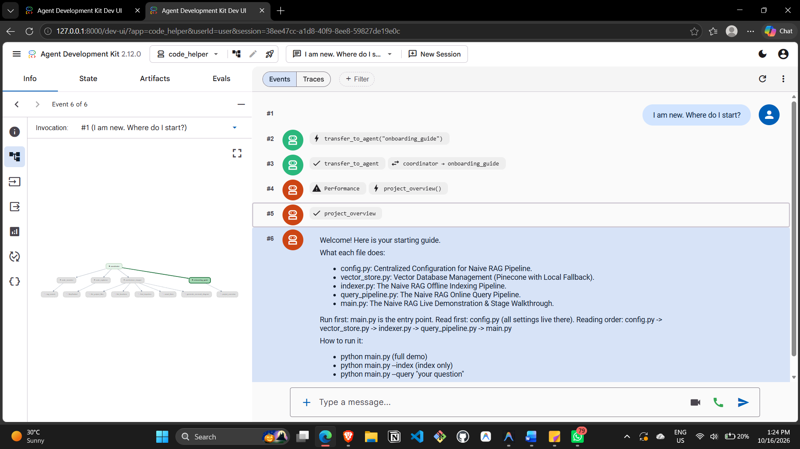

# Multi-Agent Code Helper

A team of 5 AI agents that answers questions about a code project. A **coordinator** reads each question and routes it to one of four specialist **workers**. Built with **Google ADK**, a hand-built **RAG pipeline** (NVIDIA NIM embeddings + Pinecone) and a **Filesystem MCP server**.

The helper studies a small Python RAG project (`Naive_RAG/`, five files). New developers can ask where code is, what a file does, how files connect, and where to start.

## Architecture



The project being studied has this import graph (generated by the Mapper's own tool):



## Agents

| Agent | Job | Tools | Example question |
|---|---|---|---|
| **Coordinator** | Sends each question to the right worker. Never answers itself. | none (`sub_agents`) | any question |
| **Code Searcher** | Finds where something is in the code | `rag_search` (RAG over Pinecone) | Where is the search for similar vectors done? |
| **Code Explainer** | Reads a whole file and explains it | Filesystem MCP `read_text_file` | Explain indexer.py |
| **Architecture Mapper** | Files, functions, imports, line counts, diagrams | 5 plain-Python tools | Which files import config.py? |
| **Onboarding Guide** | What the project does, reading order, how to run | `project_overview` | I am new. Where do I start? |

## Tools (7 custom functions)

| Tool | Used by | Calls an AI model? |
|---|---|---|
| `rag_search` | Code Searcher | Embedding model only |
| `list_project_files` | Mapper | No (plain Python) |
| `list_functions` | Mapper | No (`ast` module) |
| `find_importers` | Mapper | No (`ast` module) |
| `count_lines` | Mapper | No |
| `generate_mermaid_diagram` | Mapper | No (`ast` module) |
| `project_overview` | Guide | No (`ast` module) |

The Filesystem MCP server's own tool (`read_text_file`) is extra and is not counted above.

## RAG pipeline (built from scratch, no LangChain or LlamaIndex)

| Step | What happens | File |
|---|---|---|
| 1. Read | Load every `.py` file of the sample project | `code_helper/index_codebase.py` |
| 2. Split | Sliding-window chunks of **500 characters, 100 overlap** | `code_helper/index_codebase.py` |
| 3. Embed | NVIDIA NIM `nvidia/nemotron-3-embed-1b` (2048 dimensions) | `code_helper/tools/embeddings.py` |
| 4. Store | Pinecone serverless index (2048, cosine) | `code_helper/index_codebase.py` |
| 5. Search | Embed the question, fetch the 6 closest chunks | `code_helper/tools/rag.py` |

### Chunk size decision

I tested two sizes with the question *"Which function queries Pinecone?"*:

| Chunk size / overlap | Chunks | Pinecone query call (`index.query`) in top 6? | Right file? |
|---|---|---|---|
| 800 / 150 | 63 | No (only upsert code came back) | Yes |
| **500 / 100** | **102** | **Yes** | Yes |

**Choice: 500 / 100.** Smaller chunks put the query call in its own piece, so it ranks in the top results. The cost is more chunks to embed, which only happens once when indexing.

**Known limit:** fixed-size chunks can split a function, and embeddings match wording more than intent, so the Searcher finds the right *file* more reliably than the exact *function*. The Explainer (which reads whole files) covers that gap.

## MCP server

**`@modelcontextprotocol/server-filesystem`**, attached to the Code Explainer and limited to the sample project folder. Search chunks cut files into pieces, while the MCP server reads a whole file, so the Explainer can describe a file end to end.

## Setup and run

You need Python 3.10+, Node.js (for `npx`), a free [NVIDIA NIM key](https://build.nvidia.com) and a free [Pinecone key](https://www.pinecone.io).

```powershell
git clone <this-repo-url>
cd multi-agent-code-helper
python -m venv .venv
.venv\Scripts\Activate.ps1          # Mac/Linux: source .venv/bin/activate
pip install -r requirements.txt

copy code_helper\.env.example code_helper\.env   # then paste your real keys

python code_helper\index_codebase.py   # run once: fills Pinecone
adk run code_helper                    # chat in the terminal
adk web                                # web UI with trace panel
python tests\test_tools.py             # tests for the no-AI tools
```

On Windows, if you see a `UnicodeDecodeError`, run `setx PYTHONUTF8 1` and reopen the terminal. Run `adk web` from the folder that **contains** `code_helper`.

## Demo

| Question | Answered by | Screenshot |
|---|---|---|
| Where is the search for similar vectors done? | `code_searcher` |  |
| Explain indexer.py | `code_explainer` |  |
| Which files import config.py? | `architecture_mapper` |  |
| I am new. Where do I start? | `onboarding_guide` |  |

### Sample answers

**1. "Which files import config.py?"** (`architecture_mapper`, tool `find_importers`, no AI)
> The files importing config.py are indexer.py, main.py, query_pipeline.py and vector_store.py.

**2. "Explain vector_store.py"** (`code_explainer`, MCP `read_text_file`)
> A summary of the file: it manages vectors in Pinecone Serverless with a local JSON fallback, creates the index if missing, upserts chunks, queries the closest chunks, and calculates cosine similarity by hand.

**3. "Where is the search for similar vectors done?"** (`code_searcher`, tool `rag_search`)
> Most relevant file: `vector_store.py`, where the cosine similarity code and the vector query live.

## Problems I hit and how I fixed them

1. **Answers described my own code instead of the project.** The agent kept naming `rag.py`. Cause: a re-index scanned the whole folder, so my helper's files were in Pinecone. Fix: point `PROJECT_PATH` only at the sample project, use `glob("*.py")`, wipe the index and re-index. Result: the index holds only the 5 project files (102 chunks at 500/100).
2. **Agents looped and bounced between each other** (237 events on one question). Fix: workers cannot transfer to the parent or peers, and guards stop the model after the first tool result.
3. **The small 11B model invented a tool** that did not exist. Fix: a guard that ends the Searcher turn after one real `rag_search`.
4. **MCP would not import in ADK 2.12.** Fix: install the separate `mcp` package and import `McpToolset` from `google.adk.tools.mcp_tool.mcp_toolset`.
5. **Routing mistakes** (a "where is" question went to the Mapper). Fix: ordered, keyword-based rules in the coordinator's instruction.

## Future improvements

- Chunk by function with Python's `ast` module, so each chunk is a whole function.
- Add a reranking step after retrieval.
- Add a larger chat model for the Explainer.
- Add a fifth worker that renders diagrams with a Mermaid MCP server.

## Credits

The sample project in `Naive_RAG/` comes from [voidgremlin19/Naive_RAG](https://github.com/voidgremlin19/Naive_RAG) and is used only as the code the helper studies. The agents, tools and RAG pipeline in `code_helper/` are my own work.


